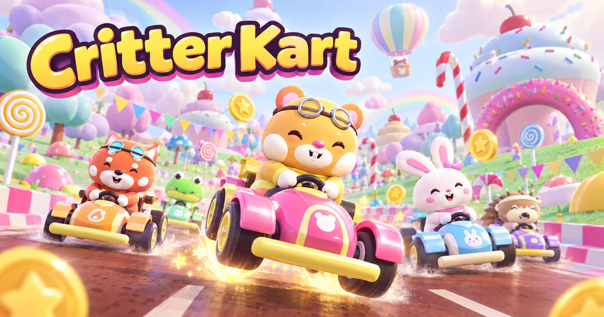

# Critter Kart（萌兽卡丁车）



**Critter Kart** は、Three.js と Rapier で作られたブラウザー向け3Dアイテムカートレースゲームです。6体のクリッターからドライバーを選び、5台のAIライバルと、ショートカットやジャンプ台、ブーストストリップがある「Sugarloop Valley」を3周します。オフラインのシングルプレイで遊べます。

## 特徴

- クリッターとカート、キャンディ風のコース景観をプロシージャルに生成
- 3段階のドリフトチャージと、段階に応じて強くなるドリフトブースト
- コインによる最高速アップ、ライバルの後ろにつくスリップストリーム
- 難易度を選べる5台のAIライバル
- 順位によって出現率が変わる7種類のアイテム
- キーボード、ゲームパッド、横画面のタッチ操作に対応
- 英語、簡体字中国語、日本語に対応（ブラウザーの言語設定から選択）

## 起動方法

必要環境: Node.js 22 以降、pnpm 10.18.0。

```bash
pnpm install --frozen-lockfile
pnpm dev
```

Vite が表示するローカルアドレスをブラウザーで開いてください。ビルドとテスト:

```bash
pnpm typecheck
pnpm test
pnpm build
pnpm smoke
```

## 操作

| 操作 | キーボード | ゲームパッド | タッチ（横画面） |
| --- | --- | --- | --- |
| アクセル | W / ↑ | RT（または A） | 自動 |
| ブレーキ／バック | S / ↓ | LT（または B） | ブレーキボタン |
| ステアリング | A / D または ← / → | 左スティック／十字キー | ステアリング操作 |
| ドリフト（離すとブースト） | Shift | RB / LB | ドリフトボタン |
| アイテムを使う | Space / E | X / Y | アイテムボタン |
| 後方を見る | C | R3 | — |
| ポーズ | Esc / P | Start | ポーズボタン |

ドリフトをためて離すとブーストします。ジャンプ中にドリフトするとトリックブースト、スタート直前にアクセルを踏むとスタートブーストが発生します。早く踏みすぎるとエンジンがストールするのでタイミングに注意してください。

コース上の**キャンディコイン**を取ると最高速が少し上がります（最大10枚）。被弾するとコインを2枚落とします。高速でライバルのすぐ後ろを走ると**スリップストリーム**のゲージがたまり、無料ブーストを獲得できます。

## アイテム

アイテムボックスを取ると、順位に応じた確率でランダムにアイテムを獲得します。

| アイテム | 効果 |
| --- | --- |
| バブルシールド | 次の攻撃を1回防ぐ |
| ペッパージェット | 短時間加速し、ショートカットの粘着エリアを突破する |
| スティッキータフィー | 後方に設置し、踏んだカートを減速させる |
| ホーミングビー | 前方のレーサーを追尾してスピンさせる |
| トリプルペッパー | ペッパージェットを3回使用できる |
| ガムボールボム | 広範囲に爆発するボム。ブレーキを押しながら使うと後方へ投げる |
| シュガーラッシュ | 無敵状態を伴う強力なレインボーブースト。ライバルをはじき飛ばす |

## 技術構成

- TypeScript、Vite、Three.js、Rapier 3D
- ゲーム、レースルール、アイテム、キャラクター: `src/game/`
- 共通エンジン（入力、物理、カート制御、スプラインAIなど）: `src/engine/`
- UI・アイコン・タッチ操作: `src/ui/`、`src/styles/`
- 翻訳: `src/i18n/`
- OG画像とファビコン: `assets/share/`

## クレジットとライセンス

フォント: Sora、Figtree、Noto Sans SC（SIL Open Font License 1.1。各フォントのライセンス文書は `public/fonts/` に収録）。ライブラリ: Three.js（MIT）、Rapier（Apache-2.0）。

このリポジトリには現在、プロジェクト本体の `LICENSE` ファイルはありません。公開リポジトリであることは、コードやゲーム素材の再利用を許諾するライセンスの付与を意味しません。
